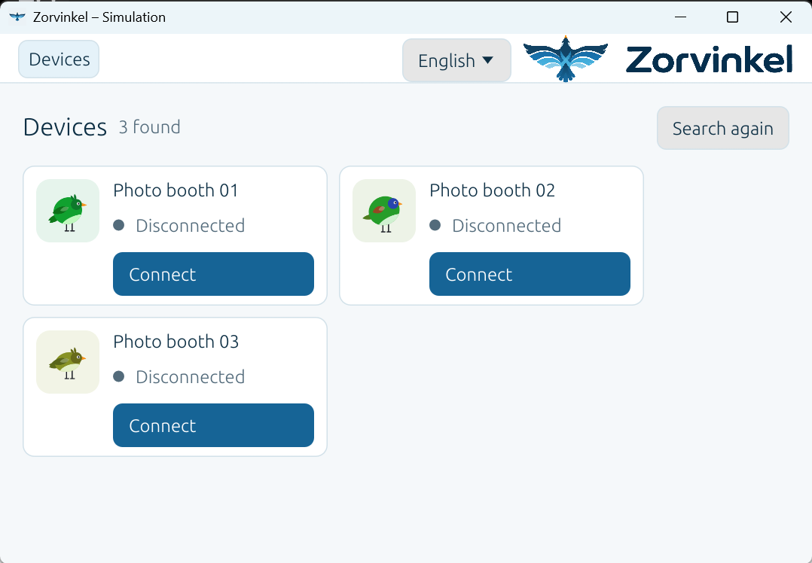
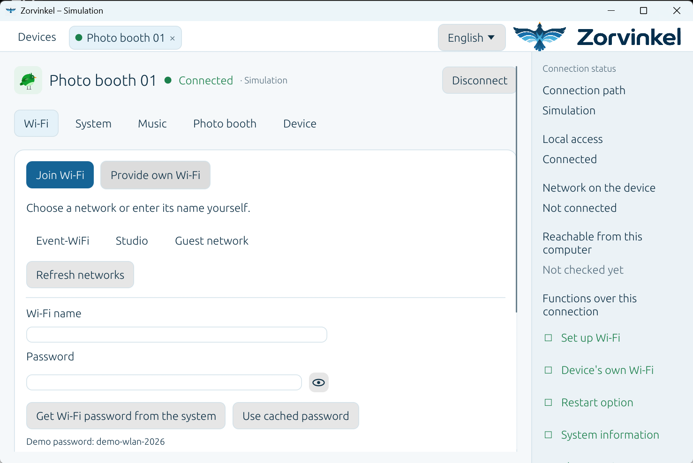

<p align="center">
  
</p>
<p align="center">
  
</p>
<p align="center"><strong>Your device. Always within reach.</strong></p>
<p align="center"><a href="https://github.com/wizkah/zorvinkel/actions/workflows/rust.yml"></a></p>

Zorvinkel is a local administration tool for headless Linux devices such as a Raspberry Pi. It lets people set up and recover a device's network connection without a screen or keyboard attached to it, even when the device has no network at all.

A graphical client (macOS, Windows, Linux) finds the device nearby over Bluetooth Low Energy (BLE) and, once it is on the local network, via mDNS/DNS-SD. It registers with the device and sets up Wi-Fi. There is no cloud and no account. Once the device is on a network, the client reaches it over IP with the same operations.

> **Status: early development (v0.1, pre-release).** The design is a draft, and parts of the implementation have only been tried on specific hardware and operating systems. The terminal over Bluetooth and the newest GUI changes have not been checked on a real device or screen. Read the [validation notes](docs/validation/) before relying on it, and do not use it to protect anything that matters yet.

<p align="center">
  
  
</p>
<p align="center"><sub>The client in simulation mode: nearby devices and Wi-Fi setup.</sub></p>

## What it does

- **Discovery:** finds devices over BLE, and over the local network via mDNS/DNS-SD.
- **Registration:** the first client to register becomes the administrator (Trust on First Use). Further clients need a grant from an already registered client or a local administrator. Keys can also be deposited in advance to avoid the first-contact risk.
- **Secure channel:** the same authenticated, encrypted message contract over BLE and IP, based on the Noise XX handshake.
- **Network setup:** scan and join Wi-Fi networks, or switch the device to its own access point (shown as a QR code) when no network is available. After a change, "Revert" switches the device back to its persisted configuration and "Persist" makes the current one the default for restarts.
- **Device information and services:** system status, power control (restart/shutdown) and configured services of the device (for example Raspotify), with optional start/stop/restart actions.
- **Terminal:** an interactive terminal to the device, an SSH session to its own `sshd` with `tmux` reattach. It runs over IP, or through an encrypted tunnel over Bluetooth when the device has no network, and follows the device when its way changes. "Easy login" can keep a session key so later logins need no password. Registering with Zorvinkel grants no shell; the device's operating-system account still logs in. See [packaging/Terminal.md](packaging/Terminal.md).
- **Local administration:** `zorvinkel-admin` grants registrations and blocks lost clients on the device itself.
- **Languages:** the GUI is available in English and German and follows the system language.

## Components

| Crate | Purpose |
|---|---|
| `zorvinkel-client` | Graphical client |
| `zorvinkeld` | Device service for Linux (needs D-Bus and BlueZ) |
| `zorvinkel-admin` | Local administration and recovery on the device |
| `zorvinkel-core` | Domain types and rules |
| `zorvinkel-application` | Client and device use cases with their ports |
| `zorvinkel-protocol` | Versioned messages and encoding |
| `zorvinkel-terminal` | SSH terminal session with `tmux` reattach and terminal emulation |
| `zorvinkel-adapters` | Platform, transport, security and storage adapters |

## Getting started

Requires a recent stable Rust toolchain (edition 2024).

Try the client without hardware, using the built-in simulation:

```sh
cargo run --locked -p zorvinkel-client --features gui -- --simulate-gui
```

Build and test everything:

```sh
cargo build --workspace --locked
cargo test --workspace --all-features --locked
```

Real Bluetooth needs the `ble-client` feature on the client and `security,ble-server` on the device service. On Linux, building needs `libdbus-1-dev` and `pkg-config`. On Windows, the client icon needs the Windows SDK resource compiler (`rc.exe`); without it the build still works with the default icon.

Packaging and installation:

- [packaging/BUILD.md](packaging/BUILD.md): macOS app bundle, Windows client build and cross-builds for the Raspberry Pi (32 and 64 bit).
- `packaging/linux/install.sh`: installs the device service on the Pi.
- [packaging/Services.md](packaging/Services.md): showing device services in the client.
- [packaging/Terminal.md](packaging/Terminal.md): requirements and the switch for the terminal on the device.

## Documentation

- [Architecture](docs/architecture/Architecture.md) and its [decision records](docs/architecture/adr/)
- [Coding guidelines](docs/development/Clean-Code.md)
- [Validation results and their limits](docs/validation/)
- [Changelog](CHANGELOG.md)

## Security

Zorvinkel's default mode trusts the first device and the first client it meets. A foreign client in range during first registration can win it, and an active attacker can impersonate a device at first contact. [Architecture §4](docs/architecture/Architecture.md) describes this limit and how to avoid it with pre-deposited keys. Please report vulnerabilities privately via GitHub's security advisories for this repository rather than in a public issue.

## License

Zorvinkel is licensed under the [GNU General Public License v3.0 or later](LICENSE). Dependency licenses are listed in [THIRD-PARTY-NOTICES.md](THIRD-PARTY-NOTICES.md) and [THIRD-PARTY-LICENSES.md](THIRD-PARTY-LICENSES.md).
