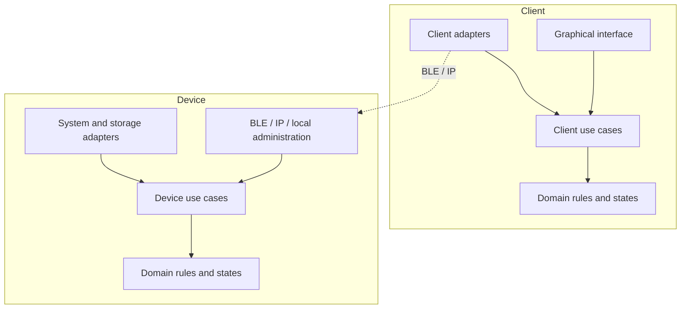
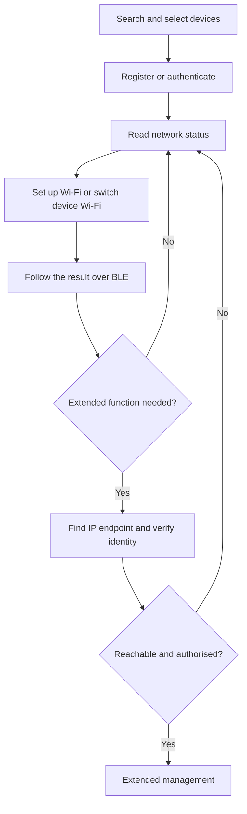

# Zorvinkel – Architecture

**Status:** Draft  
**Version:** 0.6  
**Date:** 2026-11-16  
**Implementation:** Rust  
**Device:** Raspberry Pi / Linux  
**Client:** macOS, Windows, Linux

## 1. Core decisions

- A graphical client and a device service form the system. No cloud. The device announces itself on the local network via mDNS/DNS-SD; there are no other network services.
- BLE carries device discovery, registration, basic network status, network setup and recovery.
- IP over Wi-Fi, Ethernet or the device's own Wi-Fi carries the same operations as BLE (ADR-023) and, later, terminal and files. Bluetooth Classic is not planned.
- Clean Architecture determines the direction of dependencies. IOSP separates domain decisions and operations from their coordination.
- Domain modules stay independent of radio technology, operating system, user interface and storage format. A full IODA structure is not prescribed in addition.

## 2. Structure and dependencies

Solid arrows show source-code dependencies. Use cases define the ports they need; adapters implement them. Runtime calls to the outside go through these ports.

| Area | Responsibility |
|---|---|
| Domain core | Identities, registration rules, network intents, state transitions, authorisation decisions |
| Device application | Registration, authentication release, network setup, restart configuration, recovery |
| Client application | Device discovery, trust store, guided setup, connection choice, status presentation |
| Inbound adapters | UI, received protocol commands, local administrator commands |
| Outbound adapters | BLE, IP, cryptography, NetworkManager, wpa_supplicant/dhcpcd, persistence, key storage, operating system access |
| Start-up modules | Load configuration, wire up concrete adapters, start services and background tasks |

Integrations coordinate operations and pass their results on. Rules such as "is registration allowed?" or "which configuration after a restart?" live in separately testable operations. Technical error handling and asynchronous coordination stay in the responsible flow; artificial micro-functions are not required.

### Rust layout

A Cargo workspace with the following boundaries is sufficient:

| Crate / program | Content |
|---|---|
| `zorvinkel-core` | Domain types and pure operations |
| `zorvinkel-application` | Separate client and device flows and their port traits; depends on `zorvinkel-core` |
| `zorvinkel-protocol` | Versioned messages and encoding; no system access |
| `zorvinkel-adapters` | Platform modules, transport, security, storage and UI integration |
| `zorvinkel-client` | Graphical entry point and wiring |
| `zorvinkeld` | Linux service entry point and wiring |
| `zorvinkel-admin` | Local administrative approval and recovery |

Core and application import neither adapters nor UI, BLE, D-Bus or runtime types. Protocol types are translated into application commands at the entry point. Platform modules are included depending on the target. Further crates are added only at an actual module or build boundary.

States are modelled with `enum`, identifiers with dedicated types and expected errors with `Result`. Traits sit at replacement and test boundaries. Asynchronous execution and bounded message channels belong to the runtime; domain decisions stay synchronous. Time and randomness are supplied in a controllable way.

## 3. Ports and adapters

| Port | Purpose / adapter |
|---|---|
| `DeviceDiscovery` | BLE search; an understandable display name plus a short distinguishing identifier. The interface derives an avatar from it for recognition; it is not proof of trust |
| `SecureChannel` | Authenticated message channel over BLE or IP |
| `IdentityStore` | Store the own private identity protected; no export function |
| `RegistryStore` | Store registered public keys and registration grants transactionally |
| `NetworkControl` | Wi-Fi scan, status, profiles, connection and AP; NetworkManager over D-Bus or wpa_supplicant/dhcpcd |
| `SettingsStore` | Restart option, default configuration and change journal |
| `ClientCredentialSource` | Retrieve saved Wi-Fi credentials on explicit request; manual entry if refused or unsupported |
| `EndpointDiscovery` | Determine IP candidates from authenticated BLE status and mDNS/DNS-SD; the client searches BLE and the network together and prefers the network (ADR-023) |
| `AdminAccess` | Local administration commands over a Unix socket with operating-system permission check |

Client adapters encapsulate the respective operating-system APIs for Bluetooth, secure key storage and Wi-Fi credentials. A shared Rust interface does not replace a per-platform check. The GUI toolkit and concrete libraries are chosen through a small feasibility proof.

The GUI texts live entirely in the client (ADR-029). Domain results and errors are delivered as enumerations and are turned into text of the selected language only in the interface; the state holds no rendered texts, so a language switch takes effect at once. The language setting is a client setting in the user profile and not a device state.

## 4. Identity and registration

Device and client each own a persistent key pair. The device identity is derived from the public key. Display name, radio address and IP address are not proof of trust. The client stores the accepted device identity; the device stores authorised client identities. In the MVP they have the same administrative rights.

### Registration states

| State | Behaviour |
|---|---|
| `Unclaimed` | Exactly one first client registration is allowed without additional proof of authorisation |
| `Closed` | Reject unknown clients; no automatic reopening |
| `GrantOpen` | Time-limited, single-use grant for one specific new client key |

The first registration stores the client identity and the closed state in one persistent transaction. Competing attempts cannot both succeed. The success message is sent only after the commit. If it is lost, the client that is already registered can query its status after reconnecting.

Further registrations require the grant of the intended new client key by a registered client or an authorised local administrator. Expiry or use closes the grant. Registration stays closed even after the last client is removed. A missing or damaged existing store leads to an error, not to an open re-initialisation.

### Trust at first contact

The default mode uses Trust on First Use: the device key accepted first is bound permanently. A foreign client in range can win the first registration; an active attacker can impersonate another device at first contact without a prior trust anchor. Encryption alone does not remove this limit.

This first-contact risk is accepted for the default mode. An additional code or a confirmation on the device is not required.

Alternatively, public keys can be deposited during setup over a path that is already trusted:

- An authorised local administrator or an already registered client authorises public client keys on the device. Keys and the `Closed` state are stored together persistently; unknown clients can then no longer win the first registration.
- The client deposits the expected public device key. It is checked during the very first handshake. A client key deposited only on the device does not replace this device check.

Each peer proves possession of its private key in the handshake. Private keys stay local. Deposited and already bound keys are rejected on mismatch; there is no automatic fallback to TOFU. Changes require an explicit authorised action. Key authorisation uses Zorvinkel identities; it grants no SSH or operating-system access.

### Loss and revocation

`zorvinkel-admin` allows a targeted registration grant and the blocking of lost clients over existing authorised local or remote administrative access. The public BLE/IP entry point cannot trigger this grant itself. A revocation ends the associated active sessions. Changes to device registration and to network settings are separate.

## 5. Secure communication

A security adapter protects the same message contract over BLE and IP. The design basis is Noise with the XX handshake and a check of the exchanged static keys against the respective trust store. At first contact only the trust rule described above applies; for known devices a changed key is an error.

The secured status flow uses the Noise and message profile defined in ADR-006. The choice of library and its integration are implemented and can be checked in simulation; an independent security review and native system acceptance are still outstanding. No custom cryptographic primitives and no administrative commands in handshake payloads. The [Noise specification](https://noiseprotocol.org/noise.html) describes the key exchange; the application decides whether the peer is permitted.

- Before authorisation only limited public protocol information, the handshake and an explicitly allowed registration are accessible.
- After a completed handshake the registered identity and the permitted operation are checked. A successful cryptographic handshake alone grants no administrative rights.
- Messages after the handshake are encrypted and integrity-protected; ordering, replay protection and nonces follow the security profile. Each new connection gets fresh session keys.
- When the transport changes, the same persistent peer identities are verified again. Neither old session keys nor plain bearer tokens are carried over.
- An IP connection gets a new session. It does not implicitly take over running commands or streams. A running BLE-to-IP switch is additionally correlated by a one-time, time-limited proof inside both secured sessions (operations `CorrelationIssue`/`CorrelationRedeem`, ADR-024); it can be redeemed over IP only.
- Sessions are limited in duration and message count (currently 600 s / 1024 records). The client renews them automatically before they expire or warns; a lost IP session is continued over BLE if the device is found there.
- Handshakes, messages and connections have time, size and resource limits. Unknown clients must not lock out known clients permanently through global blocks.
- Secrets appear neither in diagnostic output nor in general configuration exports. AP credentials are a separate authorised retrieval; private identity keys can never be retrieved.

### Message contract

Commands and responses contain protocol version, request ID, operation and bounded typed payload. Longer changes return an operation ID, progress and a queryable completion state. BLE fragments and reassembles messages within fixed limits; IP uses length-limited frames.

Incompatible major versions are rejected before a command is executed. Supported functions are negotiated after authentication. Unknown operations are rejected explicitly. Automatic retry of write commands is allowed only with an unchanged operation identifier and server-side deduplication; after the stored result is lost, the actual state is queried first.

## 6. Network setup and persistence

The network flow processes a domain intent such as `ConnectWifi`, `EnableAccessPoint`, `DisableAccessPoint` or `SetRestartPolicy`. The selected network adapter translates it into system operations. A device processes at most one modifying network operation at a time; status queries and BLE remain usable independently.

1. Check session, inputs and hardware capabilities.
2. Record the current state and operation identifier; store the change persistently as pending.
3. Apply the change with a time limit and observe the actual system state.
4. On success store the setting as accepted and publish the result.
5. On failure restore the previous state as far as possible, report the actual state and allow a new attempt.

System change and own storage do not form a shared transaction. After a process abort or restart, the change journal allows reconciliation instead of a blind retry. NetworkManager checkpoints are used for limited rollback where supported; they do not replace the persistent journal. The [NetworkManager API](https://www.networkmanager.dev/docs/api/latest/nm-dbus-types.html) describes the available checkpoint options.

### Adapter selection and capabilities

At start-up the device service checks the available network services and their responsibility for the interface. NetworkManager takes precedence; if it is missing, wpa_supplicant/dhcpcd is checked as a fallback. If prerequisites are missing or responsibility is unclear, the service reports the limitation and does not switch on its own. A running operation does not change the adapter.

The service checks the available adapter, system and hardware capabilities and reports them to the authenticated client. The client checks them before every offered action and shows per connection, in a clear overview, which functions the device offers and which it does not (ADR-027). Checks must not trigger a network change; the service checks again before execution.

### Ownership and restart

- The responsible network stack manages active connections and saved network profiles. Zorvinkel stores profile references, own settings and operation states. In the fallback, Wi-Fi secrets of the main network stay in the wpa_supplicant configuration; the AP credentials are in the service's protected storage (directory 0700, file 0600, atomic, no encryption on disk; ADR-026). Addressing and DHCP of the AP are handled by a root-owned helper; the service itself stays unprivileged.
- Existing foreign network profiles are not overwritten or deleted without asking. Profile changes by other tools are detected through the actual system state.
- Initialisation takes over the existing network state as the starting point and does not trigger a network switch itself.
- The restart option is either `LastAccepted` or `DefaultProfile`; both apply to Wi-Fi client and AP mode. The default is `LastAccepted`. A registered client reads and changes it through dedicated operations with a capability report (ADR-025).
- A default setting is established by a registered client declaring the currently active configuration (saved Wi-Fi or the device's own Wi-Fi) to be it; this is not possible without an active connection or for foreign access points. A set default takes precedence: new connections and the device's own Wi-Fi then stay volatile, and the default is applied again after a restart and after every rollback of an unconfirmed change. The service aligns the autostart rules of its managed profiles with the restart option; after a restart no pending change is automatically accepted as successful.
- With the wpa_supplicant fallback, a registered client chooses whether Wi-Fi connections and the device's own Wi-Fi set up successfully later survive a restart (applies to `LastAccepted`) and overwrite the original configuration, or stay volatile. The default is volatile. The choice affects later connections only; what is already saved and foreign profiles stay unchanged. The device reports the choice as a capability.
- With the wpa_supplicant fallback, a volatile Wi-Fi change, and likewise a volatile device Wi-Fi, persists only as long as it is confirmed. If no authenticated client contacts the device again within a fixed time window (currently 60 seconds), or the connection is lost several times in a row, the service reloads the saved configuration, discards the temporary profiles and applies a defined default. A device Wi-Fi that is itself the default or is to be kept is not rolled back. The "unconfirmed" state is recorded persistently and survives a restart of the service. Saved connections are not affected. This keeps the device reachable if a change interrupts the client's access.
- On its first start the service generates a distinguishable AP name `Zorvinkel-<device identifier>` and a random device-specific password and never replaces existing values. The AP is not switched on automatically as a result.
- Registered clients can read and change AP data. The interface generates text and a Wi-Fi QR code from it; it keeps no second authoritative store of credentials.

Simultaneous AP and Wi-Fi client operation is not assumed. A switch may interrupt existing IP connections; it must not end the independent BLE flow. Missing hardware capabilities are reported clearly before the change.

## 7. Client flows and reachability

The client keeps separate states for local connection, registration/authorisation, network state of the device, authenticated IP reachability and running operation. A Wi-Fi login does not mean that the client can reach the device.

IP endpoints are untrusted candidates until the stored device identity is confirmed. For the device's own Wi-Fi, current credentials and the necessary steps for switching Wi-Fi are shown. Client isolation, a firewall or a failed IP handshake affect only the IP functions; BLE setup stays usable.

The interface shows available tasks based on device capabilities, authorisation and the current channel. Domain error codes are translated into understandable messages with the next step. After an abort, the client authenticates again and queries the current operation and network state.

### Device management alongside network setup

Over the same authenticated channel the device offers, each with a capability report and equal for all registered clients:

- Shutdown and restart (ADR-016). The service only places a request; a root-owned systemd helper executes it. A device that has been shut down cannot be switched on by radio; the client asks beforehand.
- Read-only system information (ADR-019).
- A list of services described by the operator under `/etc/zorvinkel/services.d/`, with version, state and optional web interface (ADR-021). Start, stop and restart are possible only for services explicitly allowed there; a root-owned helper checks every request again against the configuration, and protected system services are excluded (ADR-022). Zorvinkel is thus not a general replacement for administration tools.

## 8. Operation and permissions

On a genuine first installation the installer creates identity and protected storage, sets up the system service and enables BLE advertising. Updates and reinstallation over existing data preserve identity and registration. The service starts automatically when the device is switched on and tolerates system services that become available late.

The device service runs under its own, as far as possible unprivileged user. Access rights for the chosen network stack are limited to the required actions. A privileged helper is used only for technically necessary, narrowly defined operations. The local administration socket allows only explicit commands after checking the operating-system identity.

Keys and configuration are stored with restrictive file permissions, atomic changes and versioned migrations. Private client keys are kept in the operating-system key store where possible. Resource budgets, bounded queues and abort handling prevent management from unnecessarily burdening the actual device application.

## 9. Later extensions

Terminal and file transfer get their own use cases and adapters behind the existing authorisation. File transfer is offered only over a confirmed IP channel.

The terminal is an SSH session run by the client (ADR-030). Over IP it connects to `sshd` directly; over BLE the device service forwards a byte stream of the encrypted channel to the local `sshd`. The BLE path is on by default and can be disabled on the device. Authentication stays with the operating system (password or a key deposited once for a specific user); registration alone grants no shell or root access. After login the client attaches to a `tmux` session, so a reconnect after an interruption or a change of transport reaches the same session. Registered Zorvinkel identities must additionally be mapped to explicitly permitted operating-system accounts and verified SSH peers. Streams get flow control, abort and defined release of resources.

For file transfer SSH/SFTP are to be examined first; file paths are limited on the server side.

A role model and additional transport paths need no changes to the network setup rules. This draft does not define a new development roadmap.

## 10. Verification and open decisions

| Check | Evidence |
|---|---|
| Core without hardware | Registration decisions, authorisations, restart options and network states as pure tests |
| Application flows | Storage, network, time and channel simulation; failure and abort at every side effect |
| Registration | Concurrent first contacts, lost response, restart, damaged storage, client loss and blocked identities |
| Protocol | Versions, replay, invalid frames, fragmentation, limits and wrong peers checked automatically |
| System integration | Adapter selection and capabilities, plus real profiles, AP switching, restart, journal reconciliation and permissions for both network stacks |
| Platforms | BLE, key storage and optional Wi-Fi credentials on macOS, Windows and Linux |
| Operation | Existing device application under load; BLE reachability during network switches |

Before an implementation release the following remain to be defined:

- Security profile (including correlation proof and session limits) and resource limits of the status flow, to be checked independently and on target systems before a product release.
- GUI toolkit, Rust libraries, minimum operating-system versions and supported hardware.
- Supported Linux configurations, responsibility for and reconciliation with existing network management, and proof of persistence and AP services of the fallback on the device.
- Concrete resource budgets and automatically handleable recovery failure cases, based on measurements.

These points are decided through targeted feasibility proofs. They do not change the domain module boundaries described here.
